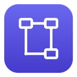
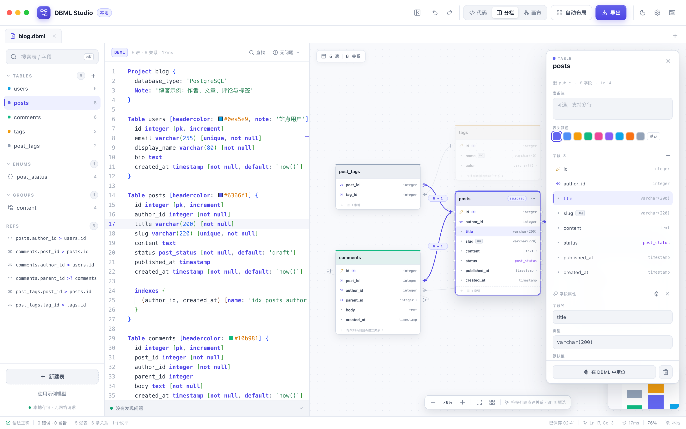
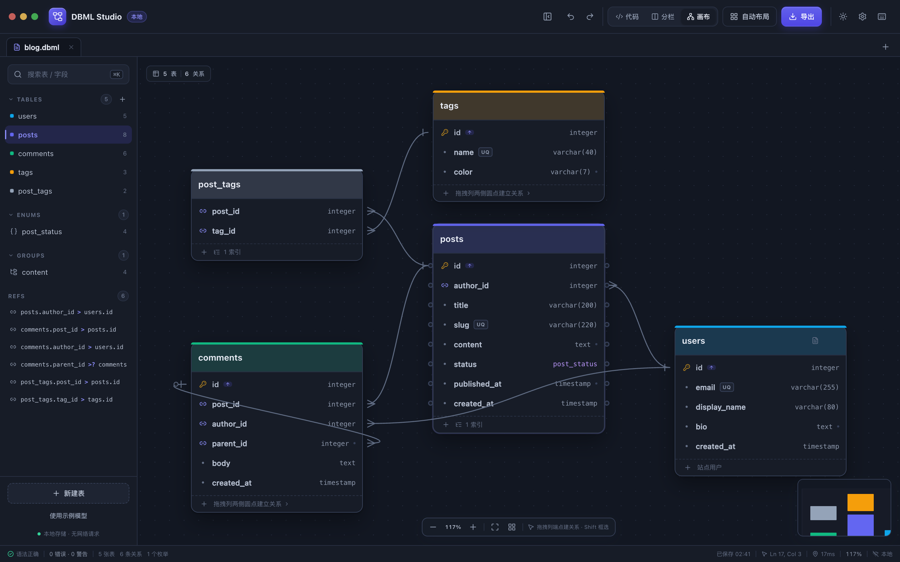

<div align="center">
  
  <h1>DBML Studio</h1>
  <p><strong>Local-first database modeling with DBML</strong></p>
  <p>Turn DBML text into an interactive entity-relationship diagram in real time.<br />No accounts, no cloud, no telemetry — your data stays on your machine.</p>

  <p>
    
    
    
    
  </p>

  <p>
    <a href="README.md">简体中文</a> ·
    <a href="#features">Features</a> ·
    <a href="#installation">Installation</a> ·
    <a href="#user-guide">User Guide</a> ·
    <a href="#keyboard-shortcuts">Shortcuts</a> ·
    <a href="#license">License</a>
  </p>
</div>

---

## Overview

DBML Studio is a desktop database modeling application for developers and data architects. It uses [DBML](https://dbml.dbdiagram.io/) (Database Markup Language) as its single source of truth: edit the text and the diagram and inspector update instantly; drag tables, connect columns, or change properties on the canvas and those changes are written back to the same DBML document.

The application runs fully offline. It contains no accounts, cloud sync, telemetry, or external network requests. Project files, canvas layouts, backups, and recovery snapshots all stay on your machine and can be versioned with Git like any other text file.

**Highlights**

- **Text as the source** — DBML is the single source of truth; the diagram is a live view of it.
- **Two-way editing** — The editor, diagram, and inspector share one model; changes on either side land in DBML.
- **Local by design** — Atomic saves, optional pre-save backups, optional auto-save, and crash recovery.
- **Keyboard accessible** — Files, views, canvas, and dialogs all have keyboard paths.
- **Light and dark parity** — Both themes carry the same hierarchy and feature completeness.

## Screenshots

<p align="center">
  
  
</p>
<p align="center">
  <sub><strong>Split view</strong> · Edit DBML while inspecting the diagram and column properties</sub>
  <br />
  <sub><strong>Canvas view</strong> · Focus on browsing, arranging, and navigating the schema</sub>
</p>

## Features

### DBML editing

- Monaco Editor with DBML syntax highlighting, bracket matching, code folding, and find.
- Live parsing on every keystroke; errors and warnings are marked inline and collected in the Problems panel.
- Completion, go-to-definition, find references, and quick fixes from the DBML language service.
- Support for schemas, enums, table groups, notes, indexes, checks, and table partials.

### Diagram

- An interactive ER diagram based on React Flow; table nodes show columns, primary keys, unique constraints, and relationship markers.
- Drag table nodes freely; drag from a column endpoint to another table to create a column-level relationship.
- One-to-many, many-to-one, one-to-one, many-to-many, and optional relationships, with cardinality labels.
- Selecting a table or relationship highlights the related chain and dims unrelated nodes.
- ELK automatic layout supports rightward and downward directions; fit-to-view, zoom, and minimap navigation.
- Shift + drag to box-select multiple tables; Delete to remove the selected table or relationship; right-click for the context menu.
- Double-click a table or relationship to reveal its declaration in the DBML editor.

### Inspector

- Edit table name, note, and header color; add or remove columns.
- Edit column name, type, default value, and note; toggle PK, UQ, NN, and AUTO constraints.
- Inspect indexes, CHECK constraints, and table partials.
- Adjust relationship type, ON DELETE / ON UPDATE actions, and relationship color.
- Every edit is written back to DBML as a minimal text edit and can be undone or redone in the editor.

### Object navigator

- Search tables by name, schema, note, or column; `⌘K` focuses the search field.
- Browse Tables, Enums, Groups, Notes, and Refs by section.
- Click an object to reveal it in both the editor and the diagram.

### Multi-document tabs

- Open multiple DBML files in one window and switch between tabs.
- Each document keeps its own content, view mode, diagram layout, selection, and undo history.
- Closing a tab, closing the window, or quitting the app handles all unsaved documents together.

### Export

- **SQL** — Generate DDL for PostgreSQL, MySQL, SQL Server, and Oracle with `@dbml/core`; preview, copy, or save it. The app never connects to or executes against a database.
- **DBML** — Export the exact source text from the editor, without canvas layout.
- **PNG** — Render the diagram in the current theme with all tables or the current view, 1x or 2x, custom padding, and an optional transparent background.

### Appearance and preferences

- Theme follows the system, light, or dark.
- Editor font size from 11 to 17 px.
- Curved or orthogonal relationship lines.
- Show column types, always show relationship labels, or show labels only on selection.
- Collapse the object navigator for a wider canvas.

### Local data safety

- Saves use a temporary file followed by an atomic replace, preventing corruption from interrupted writes.
- Before overwriting an existing file, an optional `.bak` backup is created; only the most recent one is kept.
- Optional auto-save writes about 1.4 seconds after typing stops, only when the DBML is valid and the file already has a path.
- Documents being edited generate recovery snapshots: the latest 5 per document, kept for up to 7 days.
- The welcome screen lists up to 10 recent files and flags missing files explicitly.

## Installation

### Requirements

| Item | Requirement |
| --- | --- |
| Operating system | macOS (official packages target Apple Silicon) |
| Node.js | 20.19+ or 22.12+ |
| Rust | 1.77.2 or newer |
| Build tools | Xcode Command Line Tools |

Windows and Linux use the same build flow, but no official packages are currently provided for those platforms.

### Install a release package

1. Download the latest `.dmg` from the project's release page.
2. Open the disk image and drag **DBML Studio** into Applications.
3. Launch the app from Applications or Launchpad.

If macOS warns that the developer cannot be verified on first launch, allow the app in **System Settings → Privacy & Security**.

### Run from source

```bash
# Install frontend dependencies
npm install

# Start the desktop app in development mode (starts Vite and Tauri)
npm run tauri:dev
```

### Build a release package

```bash
npm run tauri:build
```

Artifacts are written to `src-tauri/target/release/bundle/`, including a runnable `.app` and a distributable `.dmg`.

### Frontend-only preview

```bash
npm run dev
```

This runs the UI in a browser and uses `localStorage` to emulate local files, layout, and recent history. It is intended for UI development and has no native filesystem access.

## Quick start

1. **Create or open** — Choose a blank project, a built-in template, or an existing `.dbml` file on the welcome screen.
2. **Write DBML** — Edit the schema in the left editor; the diagram and inspector update live.
3. **Arrange the canvas** — Drag table nodes, connect columns, or press `L` for automatic layout.
4. **Save** — Press `⌘S` to save, or `⇧⌘S` to save a copy.
5. **Export** — Press `⌘E` to export SQL, DBML, or a PNG diagram.

## User guide

### Workspace layout

| Area | Purpose |
| --- | --- |
| Title bar | Brand, window actions, undo/redo, view switching, auto layout, export, theme, and settings |
| Tab bar | Open documents, unsaved markers, and close buttons; `+` opens a new tab |
| Object navigator | Search and browse tables, columns, enums, groups, notes, and relationships |
| Editor | DBML source, problem markers, find, and the Problems panel |
| Canvas | Interactive ER diagram, minimap, zoom controls, and context menu |
| Inspector | Structured editing for the selected table, column, or relationship |
| Status bar | Syntax status, errors/warnings, table and relationship counts, save state, cursor position, parse time, zoom, and offline state |

Switch views from the title bar or with shortcuts:

- `⌘1` Split view: editor and canvas side by side.
- `⌘2` Editor only: focus on writing DBML.
- `⌘3` Canvas only: focus on browsing and arranging the diagram.

### Creating and opening documents

- **Blank project**: creates a minimal document containing only a `Project` declaration.
- **Built-in templates**: blog, e-commerce orders, and multi-tenant SaaS, each with complete tables, relationships, and enums.
- **Open a file**: `⌘O` to choose a `.dbml` file, or open one from the recent list on the welcome screen.
- **Tabs**: `⌘N` for a new tab, `⌘W` to close the current tab, `⇧⌘W` to close the window.
- **Unsaved protection**: Closing a tab, window, or the app prompts once for all unsaved documents.

### Editing DBML

- The editor parses as you type; parse time and table/relationship counts appear in the editor header and status bar.
- Syntax errors are underlined in red and listed with positions and messages in the Problems panel.
- When the DBML is invalid, the diagram keeps the last valid version and structural editing is paused until it is fixed.
- Open the Problems panel from the status button in the editor header or the error count in the status bar.
- The cursor line/column and current zoom are shown in the status bar.

### Diagram operations

| Action | How |
| --- | --- |
| Move a table | Drag the table header |
| Create a relationship | Drag from a column's right endpoint to another table's left endpoint |
| Select | Click a table or relationship; Shift + drag empty space to box-select tables |
| Reveal | Double-click a table or relationship to jump to its declaration in DBML |
| Delete | Select and press Delete / Backspace, or use the context menu |
| Auto layout | Press `L` or click **Auto layout** in the title bar |
| Fit to view | Press `F` or use the canvas toolbar |
| Zoom | Scroll, trackpad, or the canvas toolbar; click the percentage to reset to 100% |
| Context menu | Right-click a table, relationship, or empty canvas |

### Inspector

- **Table**: rename, edit the note, choose a header color, add columns, delete the table, or reveal it in DBML.
- **Column**: edit name, type, default, and note; toggle PK / UQ / NN / AUTO; or delete the column.
- **Relationship**: adjust the relationship type, ON DELETE / ON UPDATE, color, or delete the relationship.
- Inline `Ref` delete actions and colors require expanding it into a long-form `Ref` in DBML; the relationship type can be changed directly.
- Inspector edits are text edits against DBML and can be undone or redone with `⌘Z` / `⇧⌘Z`.

### Export

#### SQL

1. Press `⌘E`, then choose **SQL**.
2. Pick a dialect: PostgreSQL, MySQL, SQL Server, or Oracle.
3. Preview the generated DDL, copy it, or save it as a `.sql` file.
4. The DBML must be valid and contain at least one table.

SQL is generated as text only; the app never connects to, executes against, or modifies a database. Type strings are converted per dialect — verify them in your target database before running.

#### DBML

- The exported content matches the editor source exactly.
- Canvas layout is not included; layout is stored in a sidecar file next to the source.
- Copy the full content or save it as a `.dbml` file.

#### PNG

- Scope: all tables or the current view.
- Resolution: 1x or 2x.
- Adjustable padding (16–120 px) and an optional transparent background.
- Rendered in the current theme, including header colors, cardinality labels, and canvas content.
- PNG export requires split or canvas view.

### Settings

Press `⌘,` to open settings:

- **Appearance**: theme and editor font size.
- **Canvas**: relationship line style, auto-layout direction, column types, and relationship labels.
- **Files and data safety**: pre-save backup and auto-save.

All settings take effect immediately and stay on your machine; nothing is uploaded or synced.

### Saving, backup, and recovery

- Saves write a temporary file next to the target, then atomically replace it.
- With pre-save backup enabled, each save of an existing file creates `name.dbml.bak`.
- With auto-save enabled, edits are written about 1.4 seconds after typing stops; only valid documents with an existing path are saved.
- Unsaved edits periodically produce recovery snapshots. If the previous session did not exit cleanly, the welcome screen offers a recovery entry.
- Up to 5 recovery snapshots are kept per document, for at most 7 days.

### File and data locations

| Path | Contents |
| --- | --- |
| `project.dbml` | DBML source file — the single source of truth |
| `project.dbml.layout.json` | Canvas layout and viewport sidecar, next to the source |
| `project.dbml.bak` | Pre-save backup, created only when backup is enabled and the file exists |
| App data directory | Recent-file records and recovery snapshots; on macOS usually `~/Library/Application Support/com.dbmlstudio.app/` |

`.dbml` files can be committed to Git independently; whether to version `.layout.json` and `.bak` files is a team decision.

## Keyboard shortcuts

> macOS uses `⌘`; Windows and Linux use `Ctrl`. Single-key canvas shortcuts pause while typing in an input field.

### File

| Action | Shortcut |
| --- | --- |
| New document | `⌘N` |
| Open DBML file | `⌘O` |
| Save | `⌘S` |
| Save as | `⇧⌘S` |
| Export | `⌘E` |
| Close tab | `⌘W` |
| Close window | `⇧⌘W` |
| Quit | `⌘Q` |

### Edit

| Action | Shortcut |
| --- | --- |
| Undo | `⌘Z` |
| Redo | `⇧⌘Z` |
| Find in DBML | `⌘F` (focus in editor) |
| Search tables or columns | `⌘K` |
| Open settings | `⌘,` |

### View

| Action | Shortcut |
| --- | --- |
| Split view | `⌘1` |
| Editor only | `⌘2` |
| Canvas only | `⌘3` |
| Auto layout | `⇧⌘L` or `L` |
| Fit to view | `⇧⌘F` or `F` |
| Toggle light/dark theme | `⇧⌘D` |
| Shortcut panel | `?` or `⌘/` |
| Close dialog / clear selection | `Esc` |

### Canvas

| Action | Shortcut |
| --- | --- |
| Delete selected table or relationship | `Delete` / `Backspace` |
| Box-select multiple tables | `Shift` + drag empty space |
| Create a relationship | Drag a column endpoint |
| Reveal in DBML | Double-click a table or relationship |

## Privacy and security

- **Fully offline** — No accounts, cloud sync, telemetry, or analytics. Everything works without a network connection.
- **Strict CSP** — Production builds load only the app's own scripts, styles, and local assets.
- **Minimal permissions** — Tauri capabilities are limited to window dragging, closing, file dialogs, and window-state restoration.
- **Local files only** — File access happens only at paths the user selects or has already authorized.
- **Safe exports** — SQL is generated as text and never executed; PNG rendering happens locally and uploads nothing.

## Technology

| Layer | Technology |
| --- | --- |
| Desktop shell | Tauri 2, Rust |
| Interface | React 19, TypeScript, Vite |
| Editor | Monaco Editor |
| DBML parsing and SQL export | `@dbml/core`, `@dbml/parse` |
| Diagram | React Flow (`@xyflow/react`), ELK |
| State and UI | Zustand, lucide-react |
| Image export | html-to-image |

## Development

| Command | Purpose |
| --- | --- |
| `npm install` | Install frontend dependencies |
| `npm run dev` | Start the frontend preview (browser mode) |
| `npm run typecheck` | Run TypeScript type checking |
| `npm run build` | Build frontend assets |
| `npm run tauri:dev` | Start the desktop app in development mode |
| `npm run tauri:build` | Build `.app` and `.dmg` packages |

Main directories:

```text
src/
  components/   Window chrome, dialogs, and shared UI components
  core/         DBML parsing, models, edits, layout, and export
  features/     Editor, canvas, inspector, sidebar, welcome, settings, export
  services/     Platform access and editor/canvas bridges
  stores/       Application state and document management
src-tauri/      Rust backend, native menus, and file commands
docs/           Design specification and screenshots
```

## License

DBML Studio is released under the [Apache License 2.0](LICENSE).

Copyright 2026 DBML Studio contributors.

## Acknowledgements

Thanks to [DBML](https://dbml.dbdiagram.io/) and [@dbml/core](https://github.com/holistics/dbml) for the database markup language and toolchain, and to [Tauri](https://tauri.app/), [React](https://react.dev/), [Monaco Editor](https://microsoft.github.io/monaco-editor/), [React Flow](https://reactflow.dev/), [ELK](https://github.com/kieler/elkjs), [Zustand](https://zustand.docs.pmnd.rs/), and [lucide](https://lucide.dev/) for the open-source foundations.
