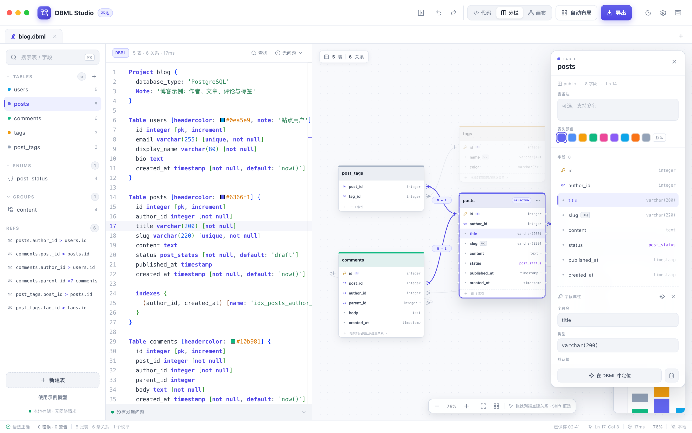
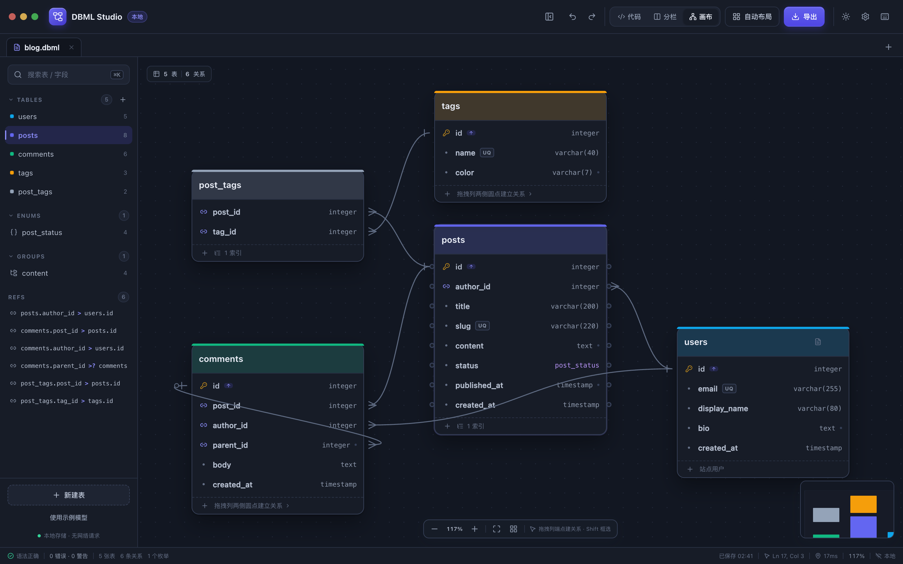

<div align="center">
  
  <h1>DBML Studio</h1>
  <p><strong>本地优先的 DBML 数据库建模工具</strong></p>
  <p>以 DBML 文本为唯一数据源，实时生成可交互的实体关系图。<br />无账号、无云端、无遥测，所有数据只保存在你的电脑上。</p>

  <p>
    
    
    
    
  </p>

  <p>
    <a href="README.en.md">English</a> ·
    <a href="#功能">功能</a> ·
    <a href="#安装">安装</a> ·
    <a href="#使用手册">使用手册</a> ·
    <a href="#键盘快捷键">快捷键</a> ·
    <a href="#开源协议">开源协议</a>
  </p>
</div>

---

## 简介

DBML Studio 是一款面向开发者与数据架构师的桌面数据库建模应用。它使用 [DBML](https://dbml.dbdiagram.io/)（Database Markup Language）作为唯一数据源：在编辑器中修改文本，关系图与属性面板即时更新；在画布上拖拽表、连接字段或调整属性，变更同样写回同一份 DBML。

应用完全离线运行，不包含账号体系、云端同步、遥测或外部网络请求。项目文件、画布布局、备份与恢复快照均保存在本机，可直接纳入 Git 进行版本管理。

**核心特性**

- **文本为源** — DBML 是唯一事实来源，关系图只是它的实时视图。
- **双向联动** — 编辑器、关系图与属性面板共享同一份模型，任一侧的修改都会落到 DBML。
- **本地可信** — 原子写入、覆盖前备份、可选自动保存与崩溃恢复快照。
- **键盘可达** — 文件、视图、画布与弹窗均提供完整的键盘路径。
- **明暗等价** — 浅色与深色主题拥有相同的信息层级与功能完整度。

## 界面预览

<p align="center">
  
  
</p>
<p align="center">
  <sub><strong>分栏视图</strong> · 编辑 DBML 的同时查看关系图与字段属性</sub>
  <br />
  <sub><strong>画布视图</strong> · 专注浏览、拖拽与整理数据库结构</sub>
</p>

## 功能

### DBML 编辑

- Monaco 编辑器提供 DBML 语法高亮、括号匹配、代码折叠与查找。
- 随输入实时解析，错误与警告直接标注在代码行上，并汇总到问题面板。
- 由 DBML 语言服务提供代码补全、转到定义、查找引用与快速修复。
- 支持多 Schema、Enum、TableGroup、Note、Index、Check 与 TablePartial 等 DBML 结构。

### 关系图

- 基于 React Flow 的可交互 ER 图，表节点展示字段、主键、唯一约束与关系标记。
- 拖拽表节点自由排布；从字段端点拖拽即可建立列级关系。
- 支持一对多、多对一、一对一、多对多及可选关系，并显示基数标签。
- 选中表或关系时高亮相关链路，弱化无关节点。
- ELK 自动布局支持向右与向下两种方向；可适应画布、缩放与缩略图导航。
- Shift + 拖拽框选多张表；Delete 删除选中的表或关系；右键打开上下文菜单。
- 双击表或关系，可在 DBML 中定位到对应声明。

### 属性面板

- 编辑表名、表备注与表头颜色，新增或删除字段。
- 编辑字段名、类型、默认值与备注，切换 PK、UQ、NN、AUTO 约束。
- 查看索引、CHECK 与 TablePartial 等结构信息。
- 调整关系类型、ON DELETE / ON UPDATE 动作与关系颜色。
- 所有修改都以最小编辑的形式写回 DBML，可由编辑器撤销与重做。

### 对象导航

- 按表名、Schema、备注或字段名即时搜索，`⌘K` 直接聚焦搜索框。
- 分组浏览 Tables、Enums、Groups、Notes 与 Refs。
- 点击对象可同时在编辑器与画布中定位。

### 多文档标签页

- 在同一窗口内打开多个 DBML 文件，按标签切换。
- 每个文档独立保存内容、视图模式、画布布局、选区与撤销历史。
- 关闭标签页、关闭窗口或退出应用时，统一处理所有未保存文档。

### 导出

- **SQL** — 由 `@dbml/core` 生成 PostgreSQL、MySQL、SQL Server 与 Oracle 建表语句，可预览、复制或保存。应用不会连接或执行任何数据库操作。
- **DBML** — 导出与编辑器完全一致的源文本，不包含画布布局。
- **PNG** — 按当前主题渲染关系图，支持全部表 / 当前视图、1x / 2x、留白与透明背景。

### 外观与偏好

- 主题支持跟随系统、浅色与深色。
- 编辑器字号 11–17px 可调。
- 关系线可选曲线或正交折线。
- 可显示字段类型、始终显示关系标签，或仅在选中时显示。
- 可折叠对象导航，获得更宽的画布。

### 本地数据安全

- 保存采用「临时文件 + 原子替换」，避免写入中断造成文件损坏。
- 覆盖已有文件前可自动生成 `.bak` 备份，仅保留最近一次。
- 可选自动保存：停止编辑约 1.4 秒后写入，仅在 DBML 语法正确且文件已有路径时生效。
- 编辑中的文档会生成恢复快照，每个文档保留最近 5 份、最长 7 天。
- 欢迎页展示最近打开的文件，最多 10 个；文件缺失时会明确标记。

## 安装

### 系统要求

| 项目 | 要求 |
| --- | --- |
| 操作系统 | macOS（官方发布包面向 Apple Silicon） |
| Node.js | 20.19+ 或 22.12+ |
| Rust | 1.77.2 及以上 |
| 构建工具 | Xcode Command Line Tools |

Windows 与 Linux 使用相同的构建流程，但当前版本未提供官方发布包。

### 安装发布包

1. 从项目发布页下载最新的 `.dmg`。
2. 打开磁盘映像，将 **DBML Studio** 拖入「应用程序」。
3. 从「应用程序」或启动台打开应用。

首次启动时，如 macOS 提示无法验证开发者，请在「系统设置 → 隐私与安全性」中允许打开。

### 从源码运行

```bash
# 安装前端依赖
npm install

# 以开发模式启动桌面应用（自动启动 Vite 与 Tauri）
npm run tauri:dev
```

### 构建发布包

```bash
npm run tauri:build
```

构建产物位于 `src-tauri/target/release/bundle/`，包含可直接运行的 `.app` 与可分发的 `.dmg`。

### 仅前端预览

```bash
npm run dev
```

该模式在浏览器中运行界面，并使用 `localStorage` 模拟本地文件、布局与最近记录，适合界面调试，不提供原生文件系统能力。

## 快速开始

1. **新建或打开** — 在欢迎页选择空白项目、内置模板，或打开已有的 `.dbml` 文件。
2. **编写 DBML** — 在左侧编辑器中修改结构，右侧关系图与属性面板会实时同步。
3. **整理画布** — 拖拽表节点、从字段端点连线，或按 `L` 运行自动布局。
4. **保存** — 按 `⌘S` 保存；如需副本，使用 `⇧⌘S` 另存为。
5. **导出** — 按 `⌘E` 导出 SQL、DBML 或 PNG 关系图。

## 使用手册

### 工作区布局

| 区域 | 说明 |
| --- | --- |
| 标题栏 | 品牌、窗口操作、撤销/重做、视图切换、自动布局、导出、主题与设置入口 |
| 标签栏 | 打开的文档、未保存标记与关闭按钮；`+` 新建标签页 |
| 对象导航 | 搜索并浏览表、字段、枚举、分组、备注与关系 |
| 编辑器 | DBML 源文本、问题标记、查找与问题面板 |
| 画布 | 可交互 ER 图、缩略图、缩放工具与上下文菜单 |
| 属性面板 | 选中表、字段或关系后的结构化编辑 |
| 状态栏 | 语法状态、错误/警告、表与关系数量、保存状态、光标位置、解析耗时、缩放与离线状态 |

视图模式可在标题栏切换，也可使用快捷键：

- `⌘1` 分栏视图：编辑器与画布并排。
- `⌘2` 仅代码视图：专注编写 DBML。
- `⌘3` 仅画布视图：专注浏览与整理关系图。

### 创建与打开文档

- **空白项目**：创建只包含 `Project` 声明的最小文档。
- **内置模板**：博客系统、电商订单、SaaS 多租户，均包含完整的表、关系与枚举示例。
- **打开文件**：`⌘O` 选择 `.dbml` 文件；也可从欢迎页的最近记录直接打开。
- **多标签页**：`⌘N` 新建标签页，`⌘W` 关闭当前标签页，`⇧⌘W` 关闭窗口。
- **未保存保护**：关闭标签页、窗口或退出应用时，应用会集中提示保存所有未保存的文档。

### 编辑 DBML

- 编辑器随输入实时解析；解析耗时与表/关系数量显示在编辑器头部与状态栏。
- 语法错误会以红色波浪线标注，并在问题面板中列出位置与说明。
- 当 DBML 存在错误时，画布保留上一次有效版本，结构编辑暂时禁用，修复后自动恢复。
- 问题面板可通过编辑器头部的状态按钮或状态栏的错误计数打开。
- 光标所在行、列与当前缩放比例显示在状态栏。

### 关系图操作

| 操作 | 方式 |
| --- | --- |
| 移动表 | 拖拽表头 |
| 建立关系 | 从字段右侧端点拖拽到另一张表的字段左侧端点 |
| 选择 | 单击表或关系；Shift + 拖拽空白区域框选多张表 |
| 定位 | 双击表或关系，跳转到 DBML 中的声明 |
| 删除 | 选中后按 Delete / Backspace，或使用右键菜单 |
| 自动布局 | 按 `L`，或点击标题栏「自动布局」 |
| 适应画布 | 按 `F`，或点击画布右下角工具条 |
| 缩放 | 滚轮、触控板或画布右下角工具条；点击百分比可重置为 100% |
| 上下文菜单 | 在表、关系或空白区域右键 |

### 属性面板

- **表**：重命名、编辑备注、选择表头颜色、新增字段、删除表，或在 DBML 中定位。
- **字段**：编辑名称、类型、默认值与备注，切换 PK / UQ / NN / AUTO，或删除列。
- **关系**：调整关系类型、ON DELETE / ON UPDATE、关系颜色，或删除关系。
- 内联 `Ref` 的删除动作与颜色需要在 DBML 中展开为长 `Ref` 后才能编辑；关系类型可直接调整。
- 属性面板中的修改会以文本编辑的形式写回 DBML，可使用 `⌘Z` / `⇧⌘Z` 撤销与重做。

### 导出

#### SQL

1. 按 `⌘E` 打开导出面板，选择 **SQL**。
2. 选择方言：PostgreSQL、MySQL、SQL Server 或 Oracle。
3. 预览生成的建表语句，可复制全部或保存为 `.sql` 文件。
4. 导出前需确保 DBML 语法正确且至少包含一张表。

SQL 仅作为文本生成，应用不会连接、执行或修改任何数据库。类型字符串会按方言转换，请在目标数据库中验证后再执行。

#### DBML

- 导出内容与编辑器中的源文本完全一致。
- 不包含画布布局；布局保存在同目录的 sidecar 文件中。
- 可复制全部内容，或另存为 `.dbml` 文件。

#### PNG

- 范围可选「全部表」或「当前视图」。
- 清晰度支持 1x 与 2x。
- 可设置留白（16–120px）与透明背景。
- 图片按当前主题渲染，包含表头颜色、关系基数与画布内容。
- PNG 导出需要处于分栏或画布视图。

### 设置

按 `⌘,` 打开设置：

- **外观**：主题、编辑器字号。
- **画布**：关系线样式、自动布局方向、字段类型显示、关系标签显示。
- **文件与数据安全**：覆盖前备份、自动保存。

所有设置立即生效并保存在本机，不会上传或同步。

### 保存、备份与恢复

- 保存时先写入同目录临时文件，再原子替换目标文件。
- 开启「覆盖前备份」后，每次保存已有文件都会生成 `文件名.dbml.bak`。
- 开启「自动保存」后，停止编辑约 1.4 秒自动写入；仅对语法正确且已有路径的文档生效。
- 未保存的编辑会定期生成恢复快照。若上次退出不是正常关闭，欢迎页会显示恢复入口。
- 每个文档最多保留 5 份恢复快照，快照最长保留 7 天。

### 文件与数据位置

| 路径 | 内容 |
| --- | --- |
| `项目.dbml` | DBML 源文件，唯一数据源 |
| `项目.dbml.layout.json` | 画布布局与视口 sidecar，与源文件同目录 |
| `项目.dbml.bak` | 覆盖前备份，仅在启用备份且文件已存在时生成 |
| 应用数据目录 | 最近文件记录与恢复快照；macOS 通常为 `~/Library/Application Support/com.dbmlstudio.app/` |

`.dbml` 文件可独立提交到 Git；`.layout.json` 与 `.bak` 是否纳入版本管理由团队自行决定。

## 键盘快捷键

> macOS 使用 `⌘`，Windows / Linux 使用 `Ctrl`。在输入框中输入文字时，画布单键快捷键会暂停。

### 文件

| 操作 | 快捷键 |
| --- | --- |
| 新建文档 | `⌘N` |
| 打开 DBML 文件 | `⌘O` |
| 保存 | `⌘S` |
| 另存为 | `⇧⌘S` |
| 导出 | `⌘E` |
| 关闭标签页 | `⌘W` |
| 关闭窗口 | `⇧⌘W` |
| 退出应用 | `⌘Q` |

### 编辑

| 操作 | 快捷键 |
| --- | --- |
| 撤销 | `⌘Z` |
| 重做 | `⇧⌘Z` |
| 在 DBML 中查找 | `⌘F`（焦点位于编辑器时） |
| 搜索表或字段 | `⌘K` |
| 打开设置 | `⌘,` |

### 视图

| 操作 | 快捷键 |
| --- | --- |
| 分栏视图 | `⌘1` |
| 仅代码视图 | `⌘2` |
| 仅画布视图 | `⌘3` |
| 自动整理布局 | `⇧⌘L` 或 `L` |
| 适应画布 | `⇧⌘F` 或 `F` |
| 切换明暗主题 | `⇧⌘D` |
| 快捷键面板 | `?` 或 `⌘/` |
| 关闭弹窗 / 取消选中 | `Esc` |

### 画布

| 操作 | 快捷键 |
| --- | --- |
| 删除选中的表或关系 | `Delete` / `Backspace` |
| 框选多张表 | `Shift` + 拖拽空白区域 |
| 建立关系 | 拖拽字段端点 |
| 在 DBML 中定位 | 双击表或关系 |

## 隐私与安全

- **完全离线** — 应用不包含账号、云端同步、遥测或统计数据上报，断网不影响任何功能。
- **严格 CSP** — 生产构建仅允许加载应用自身的脚本、样式与本地资源。
- **最小权限** — Tauri 能力仅开放窗口拖动、关闭、文件对话框与窗口状态恢复。
- **文件本地化** — 文件读写只发生在用户主动选择或已授权的路径。
- **导出安全** — SQL 只生成文本，不连接数据库；PNG 在本地渲染，不上传任何数据。

## 技术栈

| 层 | 技术 |
| --- | --- |
| 桌面外壳 | Tauri 2、Rust |
| 界面 | React 19、TypeScript、Vite |
| 编辑器 | Monaco Editor |
| DBML 解析与导出 | `@dbml/core`、`@dbml/parse` |
| 关系图 | React Flow（`@xyflow/react`）、ELK |
| 状态与界面 | Zustand、lucide-react |
| 图片导出 | html-to-image |

## 开发

| 命令 | 作用 |
| --- | --- |
| `npm install` | 安装前端依赖 |
| `npm run dev` | 启动前端预览（浏览器模式） |
| `npm run typecheck` | 运行 TypeScript 类型检查 |
| `npm run build` | 构建前端产物 |
| `npm run tauri:dev` | 以开发模式启动桌面应用 |
| `npm run tauri:build` | 构建 `.app` 与 `.dmg` 发布包 |

主要目录：

```text
src/
  components/   窗口框架、弹窗与通用界面组件
  core/         DBML 解析、模型、编辑、布局与导出
  features/     编辑器、画布、属性面板、侧栏、欢迎页、设置与导出
  services/     平台能力、编辑器/画布桥接
  stores/       应用状态与文档管理
src-tauri/      Rust 后端、原生菜单与文件命令
docs/           设计规范与界面截图
```

## 开源协议

DBML Studio 以 [Apache License 2.0](LICENSE) 发布。

Copyright 2026 DBML Studio contributors.

## 致谢

感谢 [DBML](https://dbml.dbdiagram.io/) 与 [@dbml/core](https://github.com/holistics/dbml) 提供数据库标记语言与工具链，以及 [Tauri](https://tauri.app/)、[React](https://react.dev/)、[Monaco Editor](https://microsoft.github.io/monaco-editor/)、[React Flow](https://reactflow.dev/)、[ELK](https://github.com/kieler/elkjs)、[Zustand](https://zustand.docs.pmnd.rs/) 与 [lucide](https://lucide.dev/) 等开源项目。
